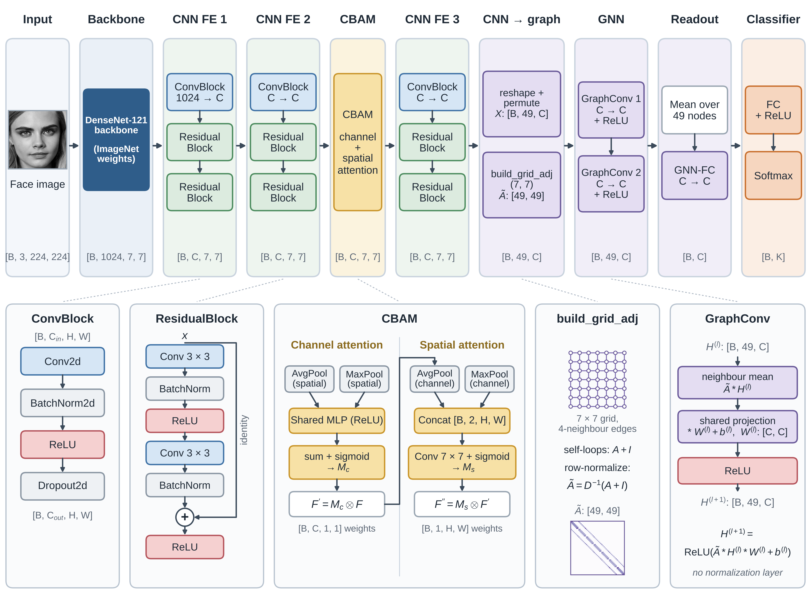

# Hybrid Attention and Grid-Graph Feature Interaction over Deep Residual Networks for In-the-Wild Facial Expression Recognition

PyTorch implementation of **DRAG-Net** (Deep Residual Attention Graph Network) for facial expression recognition.

<p align="center">
  
</p>
<p align="center"><em>Overall architecture of DRAG-Net.</em></p>

## Abstract

Facial expression recognition (FER) remains a challenging problem in affective computing due to illumination variations, pose changes, and subtle inter-class similarities among expressions. This study aims to develop a lightweight yet accurate FER model capable of capturing local facial features together with structured spatial interactions among neighboring facial regions. DRAG-Net, a Deep Residual Attention Graph Network, was proposed, integrating a pre-trained DenseNet121 backbone with attention-augmented residual learning and graph-based local feature interaction. Feature maps produced by the backbone are refined through convolutional blocks with skip connections, enhanced via a Convolutional Block Attention Module (CBAM) to emphasize expression-relevant regions, and subsequently transformed into graph representations where each spatial position constitutes an individual node. Two graph convolutional layers, operating on a fixed 7 × 7 four-neighbor grid graph, then perform local feature interaction among neighboring spatial regions, and the aggregated features are passed to a fully connected classifier for emotion prediction. The model comprises approximately 13.8 million trainable parameters and requires 3.2 GFLOPs per forward pass at 224 × 224 resolution. Evaluated on five standard benchmarks, DRAG-Net achieved 66.94% accuracy on AffectNet-7 (original protocol; 65.71% under the strict protocol) and 90.91% on FERPlus; under sample-wise five-fold cross-validation, it achieved 98.33% on KDEF, 99.90% on CK+, and 98.59% on JAFFE; under a stricter subject-independent protocol, in which the test subjects are never seen during training, it achieved 97.30% on CK+, 91.66% on KDEF, and 85.71% on JAFFE. These findings demonstrate that combining attention mechanisms with lightweight grid-graph feature interaction yields strong generalization across both controlled and in-the-wild FER scenarios.

## Datasets

DRAG-Net was evaluated on two in-the-wild datasets (AffectNet-7 and FERPlus) and three controlled-condition datasets (KDEF, CK+, and JAFFE). The datasets are not included in this repository; each can be obtained from the source listed below.

| Dataset | Setting | Images used | Classes | Evaluation protocol | Source |
|---|---|---|---|---|---|
| AffectNet-7 | In-the-wild | 283,901 training / 3,500 validation (used as the test set) | 7 (contempt not used) | Strict: 90% / 10% split of the training set for training and checkpoint selection; original: official validation set | [AffectNet](https://mohammadmahoor.com/pages/databases/affectnet/) (available on request from the dataset owners) |
| FERPlus | In-the-wild | 58,379 training / 7,341 validation / 3,543 test | 7 (contempt not used) | Predefined training, validation, and test splits | [Kaggle](https://www.kaggle.com/datasets/arnabkumarroy02/ferplus) |
| KDEF | Controlled | 2,938 (frontal and half-profile views, 70 subjects) | 7 | 5-fold sample-wise; 5-fold subject-independent (980, 2,938, and 4,898 images) | [Kaggle](https://www.kaggle.com/datasets/muhammadnafian/kdef-dataset) |
| CK+ | Controlled | 981 (123 subjects) | 7 (contempt instead of neutral) | 5-fold sample-wise; 5-fold subject-independent | [Kaggle](https://www.kaggle.com/datasets/shawon10/ckplus) |
| JAFFE | Controlled | 213 (10 subjects) | 7 | 5-fold sample-wise; leave-one-subject-out | [Zenodo](https://zenodo.org/records/14974867) |

The seven classes are anger, disgust, fear, happiness, neutral, sadness, and surprise (for CK+, contempt replaces neutral). Sample-wise protocols use StratifiedKFold; subject-independent protocols use StratifiedGroupKFold grouped by subject ID, so the test subjects are never seen during training. All images are corrected with adaptive gamma correction, aligned and cropped using facial landmarks, and resized to 224 × 224 × 3 before training.

<p align="center">
  
</p>
<p align="center"><em>Examples of the seven emotion classes. Rows from top to bottom: AffectNet, KDEF, CK+, JAFFE, and FERPlus.</em></p>

## Results

| Dataset | Protocol | Accuracy (%) |
|---|---|---|
| AffectNet-7 | Original protocol | 66.94 |
| AffectNet-7 | Strict protocol | 65.71 |
| FERPlus | Predefined test set (3,543 images) | 90.91 |
| KDEF | 5-fold sample-wise | 98.33 |
| KDEF | 5-fold subject-independent (2,938 images) | 91.66 |
| KDEF | 5-fold subject-independent (frontal view, 980 images) | 91.94 |
| CK+ | 5-fold sample-wise | 99.90 |
| CK+ | 5-fold subject-independent | 97.30 |
| JAFFE | 5-fold sample-wise | 98.59 |
| JAFFE | Leave-one-subject-out | 85.71 |

<table>
  <tr>
    <td align="center"><br>AffectNet-7 (original protocol)</td>
    <td align="center"><br>KDEF</td>
    <td align="center"><br>CK+</td>
    <td align="center"><br>JAFFE</td>
  </tr>
</table>
<p align="center"><em>Confusion matrices. KDEF, CK+, and JAFFE aggregate the out-of-fold predictions of the 5-fold sample-wise protocol.</em></p>

## Code

| Notebook | Dataset | Protocol |
|---|---|---|
| [Apply Adaptive and Gamma Correlation on Images.ipynb](Apply%20Adaptive%20and%20Gamma%20Correlation%20on%20Images.ipynb) | All | Preprocessing: adaptive gamma correction |
| [Facial Landmark.ipynb](Facial%20Landmark.ipynb) | All | Preprocessing: landmark-based alignment and cropping |
| [AffectNet_strict_protocol.ipynb](AffectNet_strict_protocol.ipynb) | AffectNet-7 | Strict protocol |
| [AffectNet_original_protocol.ipynb](AffectNet_original_protocol.ipynb) | AffectNet-7 | Original protocol |
| [FERPlusV3.ipynb](FERPlusV3.ipynb) | FERPlus | Predefined splits |
| [KDEF2938-Subject-wise-91.ipynb](KDEF2938-Subject-wise-91.ipynb) | KDEF | 5-fold subject-independent (2,938 images) |
| [KDEF980-Subject-wise-91.94.ipynb](KDEF980-Subject-wise-91.94.ipynb) | KDEF | 5-fold subject-independent (980 images) |
| [CK+Subject-Indepent.ipynb](CK%2BSubject-Indepent.ipynb) | CK+ | 5-fold subject-independent |
| [98.59_JAFFE_ablation.ipynb](98.59_JAFFE_ablation.ipynb) | JAFFE | 5-fold sample-wise and ablation study |
| [JAFFE-Subject-wise-85.71.ipynb](JAFFE-Subject-wise-85.71.ipynb) | JAFFE | Leave-one-subject-out |

### Requirements

Python 3 with `torch`, `torchvision`, `scikit-learn`, `numpy`, `pandas`, `scipy`, `matplotlib`, `seaborn`, `Pillow`, `opencv-python`, `tqdm`, and `dlib` (facial landmarks); `fvcore` is optional and is used only to count FLOPs. The DenseNet121 backbone is initialised with ImageNet weights from `torchvision`.

```bash
pip install torch torchvision scikit-learn numpy pandas scipy matplotlib seaborn pillow opencv-python tqdm dlib fvcore
```
